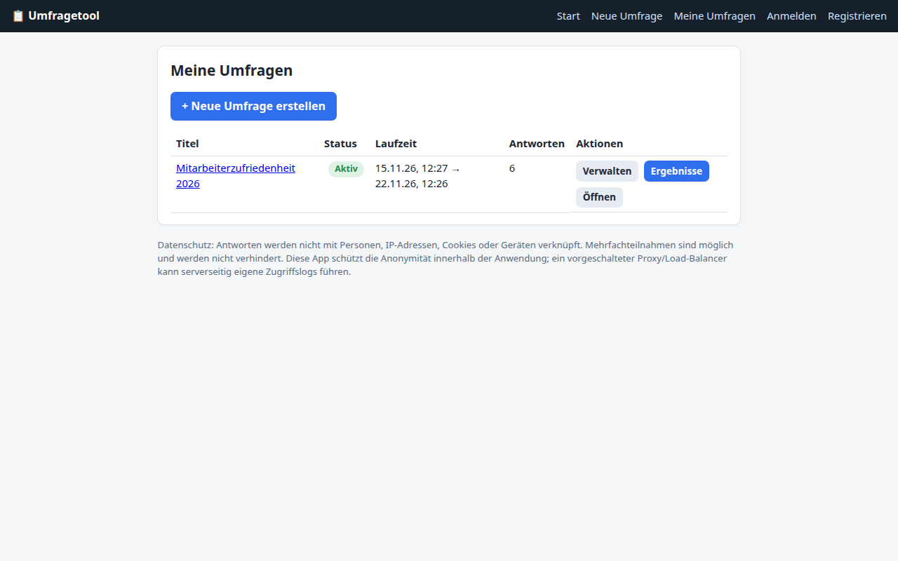
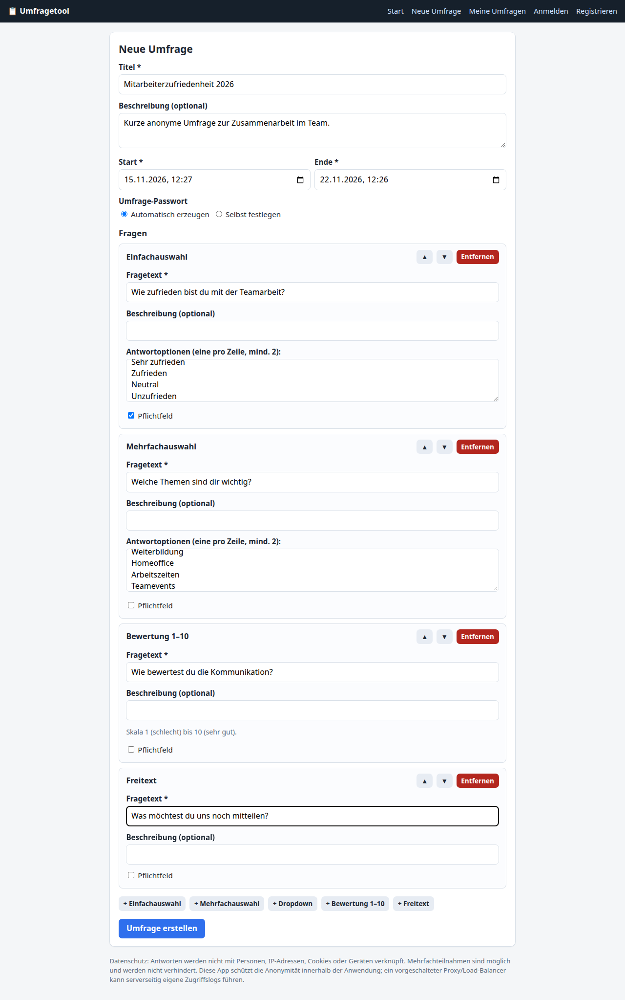
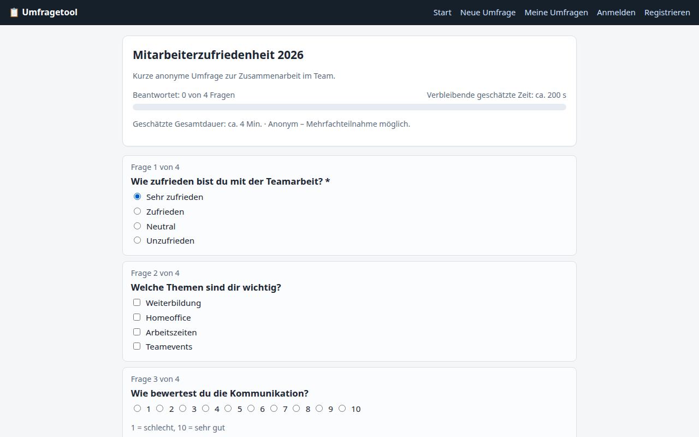
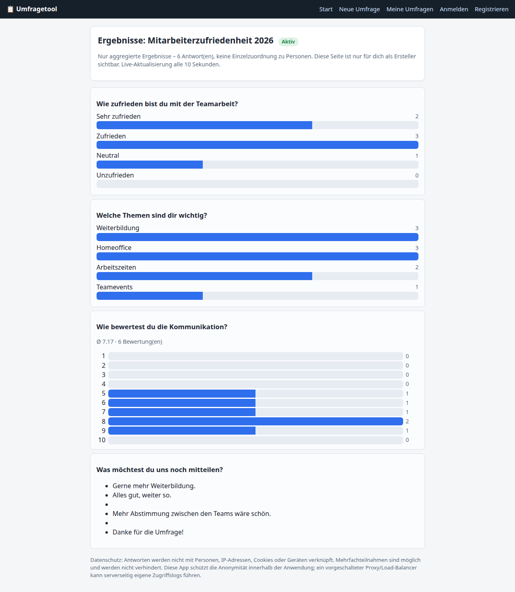

# Umfragetool-2

Ein lokales, datenschutzorientiertes Umfragetool (Node.js, Express). Antworten werden anonym gespeichert; es gibt kein Tracking.



## Was das Tool tut
- Konten: Registrierung und Anmeldung. Beim allerersten Start entsteht genau ein Admin-Konto mit zufälligem Einmal-Passwort; es steht nur dieses eine Mal im Anwendungslog.
- Umfragen erstellen und verwalten. Ergebnisse und Verwaltung sieht nur der Ersteller einer Umfrage.
- Teilnahme per schwer erratbarem Link und Umfrage-Passwort. Jede Umfrage bekommt ein Passwort (zufällig erzeugt oder selbst gewählt); es wird nur als Hash gespeichert.
- Zeitfenster mit Status (noch nicht gestartet, aktiv, abgelaufen) und Pflichtfeld-Prüfung.
- Anonymität: Antworten werden nur mit der Umfrage-ID und den Antworten gespeichert. IP-Adressen, User-Agents, Cookies oder Sitzungs-IDs von Teilnehmenden werden nicht erfasst; das Zugriffslog enthält nur Methode, Route und Status.

## Screenshots

| Ansicht | Beschreibung |
|---|---|
|  | Übersicht eigener Umfragen mit Status, Laufzeit und Anzahl Antworten. |
|  | Umfrage anlegen: Zeitfenster, Passwort und Fragen (Einfachauswahl, Mehrfachauswahl, Dropdown, Bewertung 1–10, Freitext). |
|  | Teilnahme nach Eingabe des Umfrage-Passworts. |
|  | Ergebnisse als Balkendiagramme, nur für den Ersteller sichtbar. |

Die Screenshots zeigen eine eigens angelegte Demo-Instanz mit Beispieldaten.

## Bedienung

1. Konto erstellen (**Registrieren**) und anmelden.
2. **Neue Umfrage**: Titel, Zeitfenster und Fragen festlegen. Das Umfrage-Passwort wird automatisch erzeugt oder selbst gewählt.
3. Nach dem Erstellen werden der teilbare Link und das Passwort **einmalig** angezeigt. Beides notieren und weitergeben.
4. Teilnehmende öffnen den Link, geben das Passwort ein und senden ihre Antworten ab.
5. Unter **Meine Umfragen → Ergebnisse** siehst du die Auswertung (Aktualisierung alle 10 Sekunden). **Verwalten** zeigt die Details, dort kannst du die Umfrage auch löschen.

## Erster Start und Zugang

Beim allerersten Start entsteht ein Admin-Konto mit zufälligem Einmal-Passwort, das nur dieses eine Mal im Anwendungslog steht (`docker compose logs`). Ändere das Passwort oder lege eigene Konten an.

## Daten und Backup

Alle Daten liegen in `data/store.json` (im Container `/app/data`). Sichere diese Datei bzw. das Volume `./data`.

## Update und Fehlersuche

- Update: neuen Stand einspielen, dann `docker compose up -d --build`.
- Anmeldungen nach Neustart ungültig: `SESSION_SECRET` in der `.env` setzen (sonst wird bei jedem Start ein neues erzeugt).
- Seite nicht erreichbar: `docker compose ps` prüfen und den Port 3009 freihalten.

## Starten
```bash
npm install
npm start
```
Das Tool lauscht standardmäßig auf Port 3009 (`PORT` ändert das). Die Daten liegen in `data/store.json` und werden beim ersten Start angelegt. Dieser Ordner gehört nicht ins Repository.

## Konfiguration (Umgebungsvariablen)
| Variable | Bedeutung |
|---|---|
| `PORT` | Port des Servers (Standard 3009) |
| `SESSION_SECRET` | Geheimnis für Sitzungen. Ohne Wert wird bei jedem Start ein zufälliges verwendet, dann sind Anmeldungen nach einem Neustart ungültig. Nie ins Repository schreiben. |

## Tests
```bash
npm test
```

## Container
Ein `Dockerfile` liegt bei (Port 3009). Die Daten liegen im Container unter `/app/data`; für Persistenz muss dieser Pfad als Volume eingebunden werden.

## Download

Über **Code → Download ZIP** oder unter **Releases** auf GitHub.

## Lizenz

Noch nicht festgelegt.

---

## English summary

A local, privacy-focused survey tool (Node.js/Express): create surveys with several question types, share them via a password-protected link and see live bar-chart results. Answers are stored anonymously. Start with `docker compose up -d` (port 3009).
